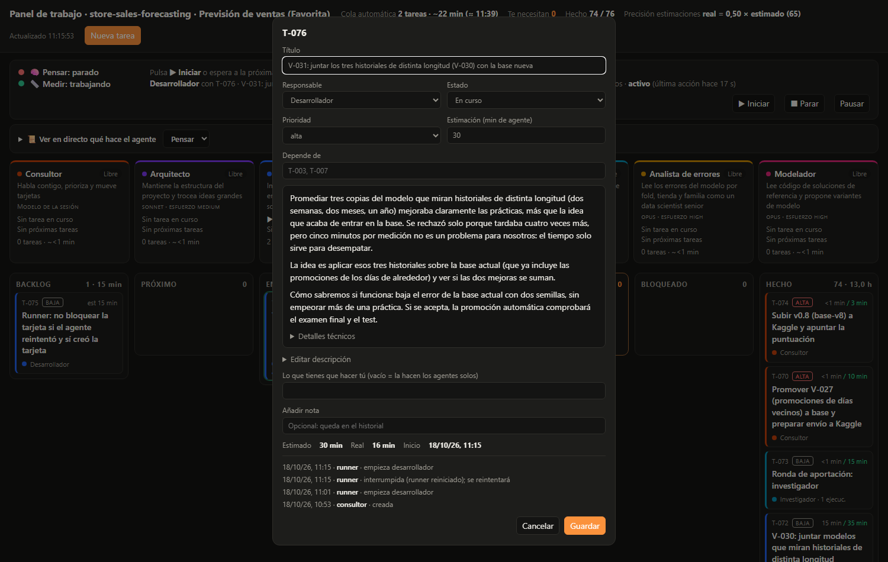
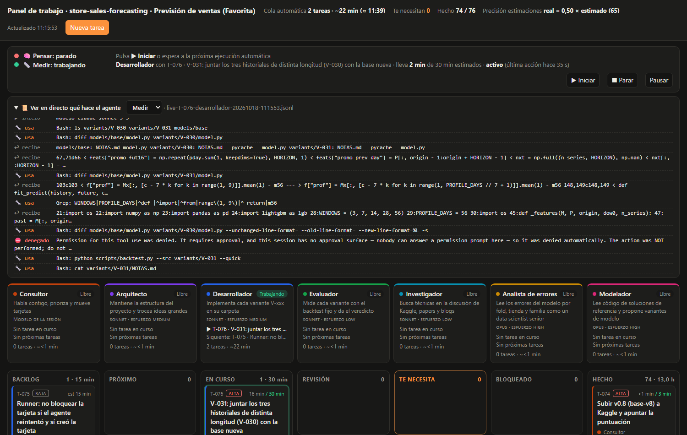

# agent-board

> 🇬🇧 *A kanban board to run a team of AI agents (consultant, architect, developer, tester, researcher, domain expert) with Claude Code — every task tracked with estimated vs. actual time.*

Base para trabajar con **Claude Code y un equipo de agentes** (consultor, arquitecto, desarrollador, tester,
investigador y un experto de dominio) coordinados en un **panel kanban** con estimaciones y tiempos reales.
Sirve para cualquier tipo de proyecto: una app, un análisis de datos, un estudio, una web…

```
Backlog → Próximo → En curso → Revisión → Hecho        + «Te necesita» y «Bloqueado»
```


*Captura de un proyecto real (store-sales-forecasting, octubre de 2026):
el carril «Medir» trabaja, el desarrollador lleva 2 minutos en su tarjeta y su última acción fue hace 35 segundos.*

## Empezar un proyecto nuevo con esta base

Dile a Claude (Claude Code, o una sesión de Claude con acceso a GitHub):

> Crea un proyecto nuevo de **<lo que sea>** usando como base el repositorio `AlbaAsca/agent-board`.
> Copia su estructura, rellena `CLAUDE.md` con el objetivo del proyecto y trabaja con su metodología:
> tú haces de consultor, el arquitecto trocea el trabajo en tareas estimadas del panel y los agentes las ejecutan.

Claude hará esto:
1. Copiar esta base en el repositorio nuevo, con `board/`, `.claude/agents/`, `CLAUDE.md` y los scripts.
2. Rellenar `CLAUDE.md`: el objetivo, el comando de tests y la estructura.
3. Renombrar `board.json → "project"` y adaptar `experto.md` al sector (delineante, abogado, analista…).
4. Pasar al arquitecto el primer bloque de tareas, con estimación, prioridad y criterio de aceptación.

A mano, en local, basta con esto:
```bash
git clone https://github.com/AlbaAsca/agent-board mi-proyecto && cd mi-proyecto
rm -rf .git && git init && git config user.name "Tu Nombre" && git config user.email tu@correo
./run-panel.sh        # Windows: run-panel.bat  →  http://localhost:8020
claude                # sesión interactiva: el consultor
```

## Cómo se trabaja

| Quién | Qué hace |
|---|---|
| **Tú** | Dices qué quieres, decides prioridades y resuelves lo que está en «Te necesita» (instalar algo, pasar un archivo, decidir). |
| **Consultor** (la sesión principal de Claude) | Habla contigo, prioriza, reparte trabajo, integra lo que entregan los agentes y te informa con datos. |
| **Arquitecto** | Diseña y trocea en tareas pequeñas (10–45 min) con criterio de aceptación y dependencias. |
| **Desarrollador** | Implementa una tarea, con tests. |
| **Tester** | Verifica lo entregado, crea **verdades de referencia independientes** y convierte cada fallo en una tarea nueva, de forma continua. |
| **Investigador** | Compara alternativas (librerías, enfoques, papers) y deja recomendación con fuentes. |
| **Experto de dominio** | Revisa con criterio del sector (adáptalo a tu proyecto). |

### Ciclo de una tarea
1. Se crea en el panel con su **estimación en minutos de agente** y su **criterio de aceptación**.
2. Al pasar a «En curso» se apunta la hora de inicio, y al pasar a «Hecho» la de fin. El **tiempo real se mide solo**.
3. El desarrollador entrega con la suite en verde y la tarea pasa a «Revisión».
4. El tester verifica. Si pasa, va a «Hecho». Si falla, vuelve con los pasos para reproducirlo.
   Lo nuevo que encuentre son tareas nuevas.
5. Commit en inglés con Conventional Commits, a tu nombre: `feat(scale): read two-tone scale bars (T-065)`.

### Agentes en paralelo
Las tareas que no se pisan las hacen varios agentes a la vez, cada uno en **su propia copia del repositorio**
(un worktree de git). El consultor junta sus ramas, resuelve conflictos, pasa la suite completa y sube.
Pídeselo así: *«haz todo en orden de prioridad, que el tester vaya sacando tareas y que cada agente trabaje en
paralelo cuando se pueda»*.

### Modo autónomo (sin conversación)
`board/runner.py` coge tareas del panel y las ejecuta con `claude -p --agent <rol>`, en este orden de prioridad:
1. Revisión (las verifica el tester).
2. Próximo.
3. Backlog.

Se arranca de tres maneras: el botón **▶ Iniciar** del panel (trabaja hasta que no quedan tarjetas), `run-agents.bat` /
`./run-agents.sh`, o de forma programada con `scripts/install-schedule.ps1` (Windows, cada 3 h).

- **Permisos limitados:** puede editar código, ejecutar Python y leer git. No puede instalar, borrar, copiar con `cp`, hacer
  commits ni `git push`, ni encadenar comandos. Tampoco carga los MCP del proyecto.
- **Commits:** los hace el runner, antes y después de cada tarea y solo con los ficheros que cambió esa tarea.
- **Dos carriles en paralelo** (`--lane think` y `--lane measure`): uno para los agentes que piensan y escriben
  (investigador, experto, arquitecto) y otro para los que ejecutan (desarrollador, tester). Así avanzan dos tarjetas a la vez
  sin que dos pruebas pesadas se peleen por la CPU.
- **Comandos denegados a la vista:** si a un agente le bloquean un comando, queda anotado en su tarjeta; si lo bloqueado
  era crear una tarjeta, la suya pasa a Bloqueado en vez de darse por hecha.
- **Sin falsos fallos:** si se agota el cupo de uso de Claude, la tarjeta vuelve a su sitio y no cuenta como error.
- **Rondas de aportación** (`--contribute`): si no hay tareas, un agente revisa el proyecto y propone como mucho dos tarjetas.
- **Pausa:** con el botón del panel o creando `board/STOP`. Los registros quedan en `board/runs/`.
- **Lo que no puede hacer solo:** si una tarea necesita algo tuyo, la pasa a «Te necesita» con instrucciones concretas.
  Si solo espera otra cosa (una medición, otra tarjeta), va a «Bloqueado».

### El panel
`python board/server.py` (o `run-panel`) → http://localhost:8020. Enlaces directos: `?open=T-012` abre una tarjeta y
`?live=think|measure|all` despliega el log en directo (útiles para compartir o para hacer capturas). Muestra:
- Columnas kanban, con arrastrar y soltar para cambiar el estado.
- Qué hace ahora cada agente, **si su proceso sigue vivo** y cuándo hizo su última acción. Si se ha caído, lo dice.
- **Ver en directo** qué está haciendo el agente (qué piensa, qué herramienta usa y qué le devuelve), sin gastar tokens:
  lee el log que la CLI escribe en `stream-json`.
- Botones **▶ Iniciar**, **■ Parar** (mata al agente y devuelve su tarjeta a Próximo) y **Pausar**.
- La estimación frente al tiempo real de cada tarea.
- Crear, editar y borrar tareas. La descripción se lee en lenguaje llano, con los detalles técnicos plegados.
- **Solicitudes de permiso** con botones Conceder / Denegar (ver más abajo).
- **Lo hecho, por versión y de un vistazo:** la columna «Hecho» tiene un bloque por versión (tags de git, patrón en
  `BOARD_VERSION_TAGS`, por defecto `v1`, `v1.2`…), de la más reciente a la más antigua, con una cuadrícula de píxeles como la
  actividad de GitHub: una casilla por tarea, del color de su agente, más clara si fue un experimento rechazado. Lo que aún no
  entró en ninguna versión aparece arriba como «En camino». Pulsando una casilla se abre la tarea; pulsando la cabecera, la lista.

| Una tarjeta, escrita para una persona | Lo que hace el agente, en directo |
|---|---|
|  |  |

### Protocolo de permisos entre agentes
Los agentes autónomos trabajan con una lista corta de comandos permitidos, y a menudo chocan con algo que necesitan.
Cuando al runner le deniegan un comando a un agente, `board/permissions.py` lo clasifica y actúa:

| Tipo | Ejemplo | Qué pasa |
|---|---|---|
| **Seguro** (solo lectura dentro del proyecto) | `git show`, `git tag --list`, `.venv/Scripts/python …` | Se concede automáticamente, queda registrado y la tarjeta se reintenta |
| **Encadenado** | `cat >> f <<EOF`, `VAR=x python …`, comandos con saltos de línea | No se concede: se le anota cómo hacerlo (un comando por llamada, Write/Edit) |
| **Prohibido** | `git push`, `pip install`, `rm`, publicar | Nunca, con el motivo anotado para que no lo reintente |
| **Dudoso** | cualquier otra herramienta | Tarjeta «Solicitud de permiso» en «Te necesita» con **Conceder / Denegar**; la tarjeta del agente espera |

El agente explica para qué lo necesita con una línea `PERMISO: <comando> — <para qué>`. Todo lo concedido o denegado queda en
`board/permissions.json` (quién, cuándo, por qué). A mano:
`python board/permissions.py list | grant "<patrón>" --why "…" | deny "<patrón>" --why "…"`.

`board/board.json` es la única fuente de verdad. Solo se modifica con `board/board.py`, que bloquea el
archivo porque escriben a la vez el panel, el modo autónomo y los agentes.

```bash
python board/board.py add "Título" --owner desarrollador --est 20 --prio alta --desc "qué y por qué, en llano

## Técnico
detalles" --deps T-003
python board/board.py move T-012 doing --by desarrollador
python board/board.py desc T-012 "nueva descripción"
python board/board.py list
```

## Ventajas de esta metodología

- **Ves el trabajo en tiempo real.** No es una conversación opaca: cada cosa es una tarea con dueño, estado,
  estimación, tiempo real e historial. Puedes irte y al volver saber qué se hizo y qué falta.
- **Estimaciones que mejoran con datos.** Como el tiempo real se mide solo, el panel compara previsión y
  realidad, y `CLAUDE.md` guarda la calibración. Si una tarea pasa de 1,5× lo previsto, se avisa con la causa
  y la nueva previsión.
- **Calidad verificable, no declarada.** El tester trabaja contra **verdades de referencia independientes**
  (hechas sin mirar el sistema) y compara elemento a elemento. Detecta fallos que un «los totales cuadran»
  esconde, y deja tests de regresión para que nada empeore sin que se note.
- **Paralelismo sin caos.** Cada agente trabaja en su copia y el consultor integra, prueba y sube. Varias
  líneas de trabajo avanzan a la vez sin pisarse.
- **Roles especializados.** Cada agente tiene instrucciones cortas y un foco claro. El desarrollador no se
  autoevalúa y el experto de dominio aporta el criterio del sector.
- **Tú solo decides.** Lo que requiere a una persona (instalar, credenciales, decisiones de producto) se
  separa en «Te necesita» con pasos concretos. El resto avanza solo.
- **Seguro por defecto.** En modo autónomo no se instala nada, no se sube nada sin ti y todo queda en git con
  commits antes y después de cada tarea.
- **Historial limpio y profesional.** Commits en inglés con Conventional Commits, a tu nombre y con el id de
  tarea, que enlaza el código con el panel.
- **Reutilizable.** La misma base sirve para cualquier proyecto: cambias `CLAUDE.md`, el experto de dominio y
  el comando de tests.

## Lecciones aprendidas (del primer proyecto, Floorplan Studio)

- Los totales engañan: hay que medir **elemento a elemento** contra una referencia independiente.
- Las tareas de calidad difícil de medir, o sobre un tipo de dato nuevo, tardaron **2–3×** lo estimado. La
  interfaz y los tests tardaron la mitad. Por eso la calibración está en `CLAUDE.md`.
- Antes de tocar una regla hay que mirar el caso real que falla, con una captura o los datos.
- Las tareas no se cierran en bloque: cada una registra su inicio y su fin, o las métricas dejan de servir.

## Lecciones de gemma-agent y store-sales-forecasting (octubre 2026)

- **El consultor mueve tarjetas, no implementa.** Si el consultor hace el trabajo, el panel deja de reflejar lo que pasa.
- **«Te necesita» solo para lo que solo puede hacer una persona.** Lo que espera una medición o a otra tarjeta va a
  Bloqueado; si no, la columna se llena de falsas alarmas.
- **Un agente puede creer que ha terminado sin haberlo hecho.** Uno encadenó `cat` y `board.py add`, se le denegó y cerró su
  tarjeta como hecha sin las tarjetas nuevas. Ahora los comandos denegados se anotan y bloquean la tarjeta.
- **Verificar no es buscar palabras.** Un tester dio por buena una función porque el nombre aparecía en el código; el bug
  salió después. El tester lee el diff, pasa los tests y prueba el comportamiento.
- **Los tests no deben tocar el panel real.** Un test del botón Parar mataba al runner de verdad cada vez que se pasaba la suite.
- **Windows tiene trampas silenciosas:** la consola en cp1252 rompe los acentos (UTF-8 forzado), la tarea programada no corre
  con batería ni recupera las perdidas, un proceso lanzado desde otra herramienta muere con ella, y la CLI de Claude que trae
  la app cambia de carpeta al actualizarse (se busca siempre la más reciente).
- **Las descripciones las lee una persona:** lenguaje llano arriba y lo técnico debajo de `## Técnico`.
- **Los permisos se piden, no se esquivan.** Un agente al que le niegan algo tiende a buscar un rodeo (heredoc, `python -c`
  de varias líneas) que también se deniega. Con el protocolo, lo seguro se concede solo y lo dudoso lo decide una persona.
- **Una instrucción contradictoria se paga:** «commits según CLAUDE.md» llevaba al desarrollador a intentar `git add`, que
  está bloqueado. Cada regla del agente tiene que ser compatible con sus permisos.

## Estructura

```
board/board.py            CLI y biblioteca del panel (con bloqueo de archivo)
board/board.json          estado: proyecto, agentes, carriles, tareas (no editar a mano)
board/server.py           servidor del panel (FastAPI) → http://localhost:8020
board/panel.html          interfaz kanban con vista en directo y control del runner
board/runner.py           modo autónomo: ejecuta tareas con `claude -p --agent <rol>`
board/permissions.py      protocolo de permisos (clasifica comandos denegados; registro en permissions.json)
.claude/agents/*.md       definición de cada agente
CLAUDE.md                 instrucciones del proyecto para Claude (plantilla a rellenar)
run-panel.*               arranca el panel
run-agents.*              arranca el modo autónomo
run-agents-scheduled.bat  lo que lanza la tarea programada (una tarjeta y sale)
scripts/install-schedule.ps1  crea la tarea programada de Windows (con batería y recuperación)
tests/                    pruebas del panel y del runner (conftest.py aísla el board.json real)
```

Requisitos: Python 3.10+, `pip install fastapi uvicorn pytest httpx` y [Claude Code](https://claude.com/claude-code)
para el modo autónomo.
