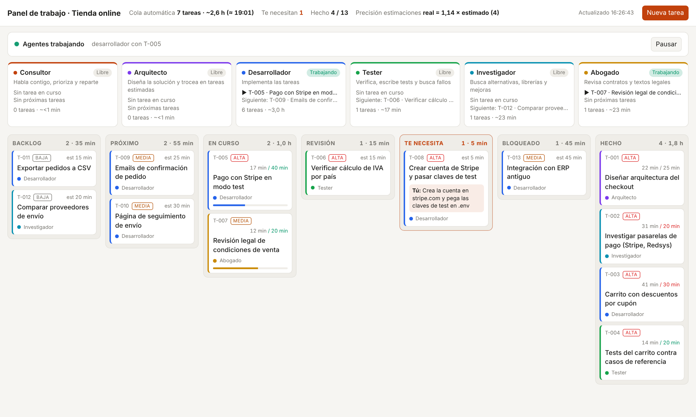

# agent-board

Base para trabajar con **Claude Code y un equipo de agentes** (consultor, arquitecto, desarrollador, tester,
investigador y un experto de dominio) coordinados en un **panel kanban** con estimaciones y tiempos reales.
Sirve para cualquier tipo de proyecto: una app, un análisis de datos, un estudio, una web…

```
Backlog → Próximo → En curso → Revisión → Hecho        + «Te necesita» y «Bloqueado»
```



*Ejemplo con datos de demostración: en cada tarea se ve el tiempo real frente al estimado (en rojo si se pasa),
qué está haciendo cada agente y qué te toca a ti («Te necesita»).*

## Empezar un proyecto nuevo con esta base

Dile a Claude (Claude Code, o una sesión de Claude con acceso a GitHub):

> Crea un proyecto nuevo de **<lo que sea>** usando como base el repositorio `AlbaAsca/agent-board`.
> Copia su estructura, rellena `CLAUDE.md` con el objetivo del proyecto y trabaja con su metodología:
> tú haces de consultor, el arquitecto trocea el trabajo en tareas estimadas del panel y los agentes las ejecutan.

Claude hará esto:
1. Copiar esta base en el repositorio nuevo, con `board/`, `.claude/agents/`, `CLAUDE.md` y los scripts.
2. Rellenar `CLAUDE.md`: el objetivo, el comando de tests y la estructura.
3. Renombrar `board.json → "project"` y adaptar `experto.md` al sector (delineante, abogado, analista…).
4. Pasar al arquitecto el primer bloque de tareas, con estimación, prioridad y criterio de aceptación.

A mano, en local, basta con esto:
```bash
git clone https://github.com/AlbaAsca/agent-board mi-proyecto && cd mi-proyecto
rm -rf .git && git init && git config user.name "Tu Nombre" && git config user.email tu@correo
./run-panel.sh        # Windows: run-panel.bat  →  http://localhost:8020
claude                # sesión interactiva: el consultor
```

## Cómo se trabaja

| Quién | Qué hace |
|---|---|
| **Tú** | Dices qué quieres, decides prioridades y resuelves lo que está en «Te necesita» (instalar algo, pasar un archivo, decidir). |
| **Consultor** (la sesión principal de Claude) | Habla contigo, prioriza, reparte trabajo, integra lo que entregan los agentes y te informa con datos. |
| **Arquitecto** | Diseña y trocea en tareas pequeñas (10–45 min) con criterio de aceptación y dependencias. |
| **Desarrollador** | Implementa una tarea, con tests. |
| **Tester** | Verifica lo entregado, crea **verdades de referencia independientes** y convierte cada fallo en una tarea nueva, de forma continua. |
| **Investigador** | Compara alternativas (librerías, enfoques, papers) y deja recomendación con fuentes. |
| **Experto de dominio** | Revisa con criterio del sector (adáptalo a tu proyecto). |

### Ciclo de una tarea
1. Se crea en el panel con su **estimación en minutos de agente** y su **criterio de aceptación**.
2. Al pasar a «En curso» se apunta la hora de inicio, y al pasar a «Hecho» la de fin. El **tiempo real se mide solo**.
3. El desarrollador entrega con la suite en verde y la tarea pasa a «Revisión».
4. El tester verifica. Si pasa, va a «Hecho». Si falla, vuelve con los pasos para reproducirlo.
   Lo nuevo que encuentre son tareas nuevas.
5. Commit en inglés con Conventional Commits, a tu nombre: `feat(scale): read two-tone scale bars (T-065)`.

### Agentes en paralelo
Las tareas que no se pisan las hacen varios agentes a la vez, cada uno en **su propia copia del repositorio**
(un worktree de git). El consultor junta sus ramas, resuelve conflictos, pasa la suite completa y sube.
Pídeselo así: *«haz todo en orden de prioridad, que el tester vaya sacando tareas y que cada agente trabaje en
paralelo cuando se pueda»*.

### Modo autónomo (sin conversación)
`run-agents.bat` / `./run-agents.sh` lanza `board/runner.py`, que coge tareas del panel y las ejecuta con
`claude -p --agent <rol>`, en este orden de prioridad:
1. Revisión (las verifica el tester).
2. Próximo.
3. Backlog.

- **Permisos limitados:** puede editar código y ejecutar tests. No puede instalar, ni descargar binarios, ni hacer `git push`.
- **Commits:** hace uno antes y otro después de cada tarea, así que cualquier cambio se deshace con git.
- **Pausa:** con el botón del panel o creando `board/STOP`. Los registros quedan en `board/runs/`.
- **Lo que no puede hacer solo:** si una tarea necesita algo tuyo, la pasa a «Te necesita» con instrucciones concretas.

### El panel
`python board/server.py` (o `run-panel`) → http://localhost:8020. Muestra:
- Columnas kanban, con arrastrar y soltar para cambiar el estado.
- Qué hace ahora cada agente y su próxima tarea.
- La estimación frente al tiempo real de cada tarea.
- Cuántas cosas te esperan y el botón de pausar o reanudar el modo autónomo.
- Crear, editar y borrar tareas.

`board/board.json` es la única fuente de verdad. Solo se modifica con `board/board.py`, que bloquea el
archivo porque escriben a la vez el panel, el modo autónomo y los agentes.

```bash
python board/board.py add "Título" --owner desarrollador --est 20 --prio alta --desc "criterio de aceptación"
python board/board.py move T-012 doing --by desarrollador
python board/board.py list
```

## Ventajas de esta metodología

- **Ves el trabajo en tiempo real.** No es una conversación opaca: cada cosa es una tarea con dueño, estado,
  estimación, tiempo real e historial. Puedes irte y al volver saber qué se hizo y qué falta.
- **Estimaciones que mejoran con datos.** Como el tiempo real se mide solo, el panel compara previsión y
  realidad, y `CLAUDE.md` guarda la calibración. Si una tarea pasa de 1,5× lo previsto, se avisa con la causa
  y la nueva previsión.
- **Calidad verificable, no declarada.** El tester trabaja contra **verdades de referencia independientes**
  (hechas sin mirar el sistema) y compara elemento a elemento. Detecta fallos que un «los totales cuadran»
  esconde, y deja tests de regresión para que nada empeore sin que se note.
- **Paralelismo sin caos.** Cada agente trabaja en su copia y el consultor integra, prueba y sube. Varias
  líneas de trabajo avanzan a la vez sin pisarse.
- **Roles especializados.** Cada agente tiene instrucciones cortas y un foco claro. El desarrollador no se
  autoevalúa y el experto de dominio aporta el criterio del sector.
- **Tú solo decides.** Lo que requiere a una persona (instalar, credenciales, decisiones de producto) se
  separa en «Te necesita» con pasos concretos. El resto avanza solo.
- **Seguro por defecto.** En modo autónomo no se instala nada, no se sube nada sin ti y todo queda en git con
  commits antes y después de cada tarea.
- **Historial limpio y profesional.** Commits en inglés con Conventional Commits, a tu nombre y con el id de
  tarea, que enlaza el código con el panel.
- **Reutilizable.** La misma base sirve para cualquier proyecto: cambias `CLAUDE.md`, el experto de dominio y
  el comando de tests.

## Lecciones aprendidas (del primer proyecto, Floorplan Studio)

- Los totales engañan: hay que medir **elemento a elemento** contra una referencia independiente.
- Las tareas de calidad difícil de medir, o sobre un tipo de dato nuevo, tardaron **2–3×** lo estimado. La
  interfaz y los tests tardaron la mitad. Por eso la calibración está en `CLAUDE.md`.
- Antes de tocar una regla hay que mirar el caso real que falla, con una captura o los datos.
- Las tareas no se cierran en bloque: cada una registra su inicio y su fin, o las métricas dejan de servir.

## Estructura

```
board/board.py        CLI y biblioteca del panel (con bloqueo de archivo)
board/board.json      estado: proyecto, agentes, tareas (no editar a mano)
board/server.py       servidor del panel (FastAPI) → http://localhost:8020
board/panel.html      interfaz kanban
board/runner.py       modo autónomo: ejecuta tareas con `claude -p --agent <rol>`
.claude/agents/*.md   definición de cada agente
CLAUDE.md             instrucciones del proyecto para Claude (plantilla a rellenar)
run-panel.*           arranca el panel
run-agents.*          arranca el modo autónomo
tests/test_board.py   pruebas del panel
```

Requisitos: Python 3.10+, `pip install fastapi uvicorn` y [Claude Code](https://claude.com/claude-code)
para el modo autónomo.
